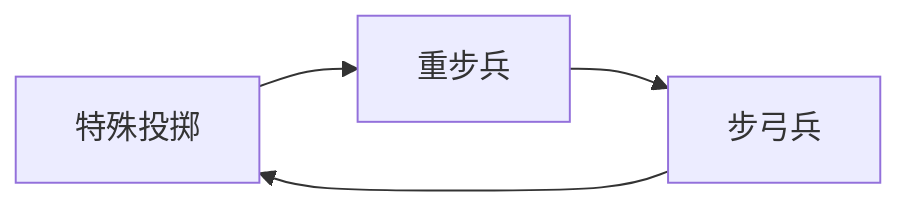

# 五方十国兵种与国家特性设计方案

## 1. 设计目标

构建一套策略游戏兵力体系：五大方位、十个国家。国家共享同一套战斗规则，再通过方位体质和国家特色拉开打法。

地图没有海洋，只有湖泊。湖泊是地形和行军障碍，不存在水军、舟师或接舷战。

核心原则：

- **基础战斗兵种**共九类。所有国家都能招募，并共用一张闭环克制表。
- **辅助兵种**只有功能，不进入兵种相克。
- **方位体质**改变疲劳、地形和负重，不新增第十类战斗兵。
- **国家特色战斗兵种**每国 3 种，必须归入九类原型之一，继承该原型的克制。
- **同级特色兵可以击败克制自己的普通兵。** 中央靠更高数字和 1 个弱机制，四方靠 2–3 个机制，两边都会付出伤亡。
- **精英兵**每国只从特色兵里选 1 种。初始数字和成长更高，经验更贵，上限 30 级，必定有 1 个被动。
- **普通兵**上限 20 级，从民兵晋升。平民走步兵线，地主走骑兵线。
- 五方设定是游戏原型，不代表对历史族群的概括。

参考来源：

- 《帝国时代》：枪兵克骑兵、骑兵克远程、弓兵克脆皮步兵、骆驼式骑兵专克骑兵、散兵克弓、剑士克枪兵。克制是职责，不是同一兵种的数值放大。
- 《骑马与砍杀》：长杆拒止冲锋、盾墙削减箭矢、轻骑追死弓兵和骑射手、骑射在开阔地风筝慢速重兵、标枪短程破甲。阵型、地形和冲锋是否接上，会改写纸面克制。

## 2. 五方十国总览

编号按本表从上到下，不按方位重新起号。

| 编号 | 方位 | 国家 | 核心战斗风格 |
| --- | --- | --- | --- |
| G1 | 东方·夷 | 青岚国 | 山林步弓、林缘骑射 |
| G2 | 东方·夷 | 苍羽国 | 丘陵步弓、重步、枪阵 |
| G3 | 南方·蛮 | 百岭国 | 临湖轻步、平原重步、湖弓 |
| G4 | 南方·蛮 | 炽焰国 | 山林火攻、轻步、步投 |
| G5 | 西方·戎 | 玄戈国 | 重步、步投、山林轻步 |
| G6 | 西方·戎 | 昆岳国 | 特殊骑兵、沙漠骑投、轻骑 |
| G7 | 北方·狄 | 朔风国 | 沙漠骑射、轻骑，草原重骑 |
| G8 | 北方·狄 | 烈庭国 | 草原重骑、骑射、追击 |
| G9 | 中央·华夏 | 天衡国 | 平原枪阵、重步、步弓，一个弱机制 |
| G10 | 中央·华夏 | 昭武国 | 平原重步、轻步、重骑，一个弱机制 |

### 2.1 强度 Q 与兵种编号 B

Q 只比较**同一个兵种在不同国家**的强弱。Q5 最强，Q1 最弱。不能用 Q 比较轻步兵和重骑兵。

胜负先看兵种相克，再看地形、等级、该国该兵种的 Q，以及特色兵、精英兵额外更高的数值和机制。Q 差 1 档约等于 10% 面板（Q3 = 100）。一次主克制约 25%–40%，所以只差一两档 Q，克制仍然成立。Q5 对上 Q1，强度差才大致抵得过一次克制，这时地形和等级会把结果拉开。

编号顺序不变：民兵、普通战斗兵、辅助兵，再按 G1 到 G10 每个国家 3 个特色兵。精英沿用原特色兵的编号。辅助兵没有 Q。特色兵和精英兵也不另评 Q，它们继承本国原型的 Q，再叠加更高的数值。

以下为各国基础兵种强度源数据。特色兵、精英兵和国家文化都从这张表倒推，不另起一套数字。最后一列是 B3–B12 的合计，不含民兵。四方合计都是 35，中央是 38。中央更均衡，不是每一格都更高。朔风、烈庭的骑兵行就高于天衡、昭武。

倒推规则：特色兵只从该国 Q4、Q5 的基础战斗兵里选原型。Q5 优先；不足三个时用 Q4 补齐。Q5 超过三个时，留下能吃到该国主地形加成、且原型不重复的三个。精英是其中最代表主地形和最高 Q 的一个。Q3 及以下不作为特色原型。

| 国家 | B1 平民 | B2 地民 | B3 轻步 | B4 重步 | B5 枪兵 | B6 轻骑 | B7 重骑 | B8 特殊骑 | B9 步弓 | B10 骑射 | B11 步投 | B12 骑投 | 合计 |
| --- | --- | --- | --- | --- | --- | --- | --- | --- | --- | --- | --- | --- | --- |
| G1 青岚 | 5 | 3 | 2 | 2 | 3 | 4 | 4 | 3 | 5 | 5 | 3 | 4 | 35 |
| G2 苍羽 | 5 | 3 | 3 | 4 | 4 | 3 | 3 | 3 | 5 | 4 | 3 | 3 | 35 |
| G3 百岭 | 5 | 3 | 5 | 5 | 4 | 3 | 3 | 2 | 4 | 3 | 3 | 3 | 35 |
| G4 炽焰 | 5 | 3 | 5 | 3 | 4 | 3 | 2 | 3 | 4 | 3 | 5 | 3 | 35 |
| G5 玄戈 | 4 | 4 | 4 | 5 | 3 | 3 | 3 | 3 | 3 | 3 | 5 | 3 | 35 |
| G6 昆岳 | 4 | 4 | 3 | 3 | 2 | 4 | 4 | 5 | 3 | 3 | 3 | 5 | 35 |
| G7 朔风 | 3 | 5 | 2 | 2 | 2 | 5 | 5 | 5 | 2 | 5 | 2 | 5 | 35 |
| G8 烈庭 | 3 | 5 | 3 | 2 | 3 | 5 | 5 | 4 | 3 | 5 | 2 | 3 | 35 |
| G9 天衡 | 4 | 5 | 4 | 4 | 5 | 4 | 4 | 3 | 4 | 4 | 3 | 3 | 38 |
| G10 昭武 | 5 | 4 | 4 | 5 | 4 | 4 | 4 | 3 | 4 | 4 | 3 | 3 | 38 |

| 编号 | 名称 | 归属 | 阶 | 原型 | 继承基础 |
| --- | --- | --- | --- | --- | --- |
| B1 | 平民民兵 | 全 | 民兵 | 临时轻步兵 | 见上表 B1 |
| B2 | 地主民兵 | 全 | 民兵 | 临时轻骑兵 | 见上表 B2 |
| B3 | 轻步兵 | 全 | 普通 | 轻步兵 | 见上表 B3 |
| B4 | 重步兵 | 全 | 普通 | 重步兵 | 见上表 B4 |
| B5 | 枪兵 | 全 | 普通 | 枪兵 | 见上表 B5 |
| B6 | 轻骑兵 | 全 | 普通 | 轻骑兵 | 见上表 B6 |
| B7 | 重骑兵 | 全 | 普通 | 重骑兵 | 见上表 B7 |
| B8 | 特殊骑兵 | 全 | 普通 | 特殊骑兵 | 见上表 B8 |
| B9 | 步弓兵 | 全 | 普通 | 步弓兵 | 见上表 B9 |
| B10 | 骑射手 | 全 | 普通 | 骑射手 | 见上表 B10 |
| B11 | 步投 | 全 | 普通 | 特殊投掷兵 | 见上表 B11 |
| B12 | 骑投 | 全 | 普通 | 特殊投掷兵 | 见上表 B12 |
| B13 | 工兵 | 全 | 辅助 | — | 无 |
| B14 | 辎重兵 | 全 | 辅助 | — | 无 |
| B15 | 连弩精兵 | G1 | 精英 | 步弓兵 | G1 的 B9 = Q5 |
| B16 | 岚射骑 | G1 | 特色 | 骑射手 | G1 的 B10 = Q5 |
| B17 | 岚标骑 | G1 | 特色 | 特殊投掷兵 | G1 的 B12 = Q4 |
| B18 | 丘弓 | G2 | 精英 | 步弓兵 | G2 的 B9 = Q5 |
| B19 | 丘盾 | G2 | 特色 | 重步兵 | G2 的 B4 = Q4 |
| B20 | 丘枪 | G2 | 特色 | 枪兵 | G2 的 B5 = Q4 |
| B21 | 岸刀 | G3 | 精英 | 轻步兵 | G3 的 B3 = Q5 |
| B22 | 岭盾 | G3 | 特色 | 重步兵 | G3 的 B4 = Q5 |
| B23 | 湖弓 | G3 | 特色 | 步弓兵 | G3 的 B9 = Q4 |
| B24 | 焚步卫 | G4 | 精英 | 轻步兵 | G4 的 B3 = Q5 |
| B25 | 火标手 | G4 | 特色 | 特殊投掷兵 | G4 的 B11 = Q5 |
| B26 | 烈矢手 | G4 | 特色 | 步弓兵 | G4 的 B9 = Q4 |
| B27 | 陷阵重甲 | G5 | 精英 | 重步兵 | G5 的 B4 = Q5 |
| B28 | 戈矛手 | G5 | 特色 | 特殊投掷兵 | G5 的 B11 = Q5 |
| B29 | 林刃 | G5 | 特色 | 轻步兵 | G5 的 B3 = Q4 |
| B30 | 破骑 | G6 | 精英 | 特殊骑兵 | G6 的 B8 = Q5 |
| B31 | 沙标骑 | G6 | 特色 | 特殊投掷兵 | G6 的 B12 = Q5 |
| B32 | 漠轻骑 | G6 | 特色 | 轻骑兵 | G6 的 B6 = Q4 |
| B33 | 精锐骑射 | G7 | 精英 | 骑射手 | G7 的 B10 = Q5 |
| B34 | 沙蹄轻骑 | G7 | 特色 | 轻骑兵 | G7 的 B6 = Q5 |
| B35 | 草原重骑 | G7 | 特色 | 重骑兵 | G7 的 B7 = Q5 |
| B36 | 狼奔重骑 | G8 | 精英 | 重骑兵 | G8 的 B7 = Q5 |
| B37 | 围猎骑射 | G8 | 特色 | 骑射手 | G8 的 B10 = Q5 |
| B38 | 追亡骑 | G8 | 特色 | 轻骑兵 | G8 的 B6 = Q5 |
| B39 | 督战枪卫 | G9 | 精英 | 枪兵 | G9 的 B5 = Q5 |
| B40 | 衡阵戟士 | G9 | 特色 | 重步兵 | G9 的 B4 = Q4 |
| B41 | 中军强弩 | G9 | 特色 | 步弓兵 | G9 的 B9 = Q4 |
| B42 | 羽林近卫 | G10 | 精英 | 重步兵 | G10 的 B4 = Q5 |
| B43 | 破军刀士 | G10 | 特色 | 轻步兵 | G10 的 B3 = Q4 |
| B44 | 武库重骑 | G10 | 特色 | 重骑兵 | G10 的 B7 = Q4 |

B11 与 B12 克制相同，只区分步行和乘骑。删除斥候后辅助兵只剩 B13、B14，特色兵改为 B15–B44。各国都能招募 B1–B14。B15–B44 只有对应国家能招募。

## 3. 兵种如何分层

```text
国家兵种池 = 民兵 ∪ 九类普通战斗兵 ∪ 辅助兵 ∪ 本国 3 种特色战斗兵
精英兵 = 本国 3 种特色战斗兵中的 1 种
```

特色兵和精英兵都不是第十类。它们带着原型进入同一张克制表。方位不新增战斗兵种，只提供环境体质、训练倾向和升级时的五维偏好。

| 层级 | 等级上限 | 是否参与相克 |
| --- | --- | --- |
| 民兵 | 晋升前计入普通兵的 20 级 | 减半执行原型克制 |
| 普通战斗兵 | 20 | 是 |
| 特色战斗兵 | 25 | 是，继承原型 |
| 精英战斗兵 | 30 | 是，继承原型 |
| 辅助兵 | 不走战斗等级 | 否 |
| 国家文化 | — | 幅度低于克制，不能单独逆转克制 |


## 4. 基础战斗兵种

九类分成三组。同一组内部要能互相找得到答案，组与组之间也要能打穿，避免某一类在开阔地没有天敌。

### 4.1 职责

| 编号 | 分组 | 兵种 | 培养档 | 职责 |
| --- | --- | --- | --- | --- |
| B3 | 步兵 | 轻步兵 | 步兵 | 低甲、高机动。绕到重兵侧后，贴脸打断投掷 |
| B4 | 步兵 | 重步兵 | 步兵 | 高甲、盾、低速。正面硬抗，贴身压制长柄，盾墙对弓 |
| B5 | 步兵 | 枪兵 | 步兵 | 长柄拒马。正面克制一切骑兵，被贴身和远程风筝 |
| B6 | 骑兵 | 轻骑兵 | 骑兵 | 高速猎兵。追杀弓、骑射、轻步和投掷，不正面撞枪阵 |
| B7 | 骑兵 | 重骑兵 | 骑兵 | 高冲击冲锋。碾压轻步、轻骑、弓兵和盾步的正面 |
| B8 | 骑兵 | 特殊骑兵 | 骑兵 | 反骑骑兵。专打其他骑兵，对步兵线没有冲锋优势。参考帝国时代骆驼兵，不是「更强的重骑」 |
| B9 | 远程 | 步弓兵 | 弓兵 | 长程持续射击。打无盾目标，用射程压制投掷 |
| B10 | 远程 | 骑射手 | 骑兵 | 移动射击。开阔地风筝枪阵、重步和重骑 |
| B11 | 远程 | 步投 | 弓兵 | 短程破甲、破盾。步行 |
| B12 | 远程 | 骑投 | 骑兵 | 与步投同一克制，差别只在乘骑后的移动速度 |

特殊骑兵若做成第二重骑兵，骑兵内部就没有答案，枪兵会成为唯一解，闭环断开。特殊投掷若做成第二弓兵，远程就只剩射程竞赛。二者的职责因此写死。

同等级、同 Q 时，培养成本和单兵作战能力都是：骑兵 > 弓兵 > 步兵。

| 培养档 | 兵种 | 成本 | 单兵基准 |
| --- | --- | --- | --- |
| 步兵 | B1 平民民兵，B3 轻步兵，B4 重步兵，B5 枪兵 | 低 | 低 |
| 弓兵 | B9 步弓兵，B11 步投 | 中 | 中 |
| 骑兵 | B2 地主民兵，B6 轻骑兵，B7 重骑兵，B8 特殊骑兵，B10 骑射手，B12 骑投 | 高 | 高 |

地主民兵贵于平民民兵，仍便宜于同国正规骑兵。枪兵能打重骑，靠的是相克，不是单兵基准更高。同费用下，步兵人数更多。

### 4.2 闭环克制

下表比较的是同级、同一档国家强度、地形中性的普通兵。结果是主克制，不是秒杀。国家 Q、地形、等级，以及特色兵和精英兵的额外数值，会改写这张表。特色兵对普通兵的同级胜负见第 10 节。

建议结算：主克制相当于约 25%–40% 的有效战力差。同一兵种每差 1 档 Q 约 10%。数量、士气、地形可以放大或吃掉这些差距。

读表：行是进攻方，列是防守方。

|  | 轻步 | 重步 | 枪兵 | 轻骑 | 重骑 | 特殊骑 | 步弓 | 骑射 | 投掷 |
| --- | --- | --- | --- | --- | --- | --- | --- | --- | --- |
| 轻步 | 平 | 克 | 平 | 败 | 败 | 平 | 败 | 败 | 克 |
| 重步 | 败 | 平 | 克 | 平 | 败 | 克 | 克 | 败 | 败 |
| 枪兵 | 平 | 败 | 平 | 克 | 克 | 克 | 败 | 败 | 平 |
| 轻骑 | 克 | 平 | 败 | 平 | 败 | 败 | 克 | 克 | 克 |
| 重骑 | 克 | 克 | 败 | 克 | 平 | 败 | 克 | 败 | 败 |
| 特殊骑 | 平 | 败 | 败 | 克 | 克 | 平 | 败 | 败 | 平 |
| 步弓 | 克 | 败 | 克 | 败 | 败 | 克 | 平 | 条件 | 克 |
| 骑射 | 克 | 克 | 克 | 败 | 克 | 克 | 条件 | 平 | 克 |
| 投掷 | 败 | 克 | 平 | 败 | 克 | 平 | 败 | 败 | 平 |

「条件」只发生在步弓与骑射之间：

- 开阔地，骑射手持续移动：双方不进入对射决胜，骑射手选择打不打。
- 狭窄地形、湖岸、山地、森林，或骑射手被迫停射：步弓克骑射。

骑射手在开阔地的硬解是轻骑兵。这是故意保留的骑砍式结构，用地形关掉风筝，而不是再做一个万能克星。

### 4.3 四条必须成立的环

任意一类沿箭头都能走回自己，不存在没有天敌的兵。


步骑主环：重骑冲垮轻步，轻步绕开重步，重步贴死枪兵，枪兵拒住重骑。


猎骑环：重骑对撞胜轻骑，轻骑追死骑射，骑射在开阔地风筝重骑。



破甲环：投掷破盾破甲，重步盾墙压弓，步弓用射程压投掷。投掷同样克重骑，前提是标枪在冲锋接触前命中；已经贴脸则投掷崩溃，按重骑克远程结算。


反骑环：特殊骑兵克其他骑兵，重骑冲垮步弓，步弓射杀缺少冲锋加成的特殊骑兵。把重骑换成轻骑，这条环仍然成立。枪兵则同时克制环上的两种骑兵。

补充一条远程与枪阵的环，避免弓兵无解：轻骑兵克步弓，步弓克枪兵，枪兵克轻骑兵。

### 4.4 和参考作品的对应

| 本作 | 帝国时代 | 骑马与砍杀 |
| --- | --- | --- |
| 枪兵克骑兵 | 长枪兵克骑兵 | 长杆、拒马打断冲锋 |
| 重步兵克枪兵、克步弓 | 民兵线克枪兵；近战盾兵抗箭 | 盾墙减箭，贴身打乱长杆 |
| 轻步兵克重步兵 | 快步兵绕侧、打攻城散兵 | 无盾轻兵绕到重甲侧后 |
| 轻骑兵克弓和骑射 | 轻骑、骠骑猎弓 | 轻骑追击弓兵和骑射手 |
| 重骑兵克轻兵和弓 | 骑士冲锋 | 重骑冲锋碾压松散步兵和弓兵 |
| 特殊骑兵克骑兵 | 骆驼兵、长枪骆驼 | 专门冲击敌骑、自身怕步弓和长杆 |
| 步弓克无盾单位 | 弓兵克步兵 | 弓箭消耗无盾阵列 |
| 骑射手风筝慢兵 | 骑兵弓手 | 骑射拉扯重步、枪阵、重骑 |
| 特殊投掷克重甲 | 散兵克弓；精锐掷矛破甲 | 标枪高破甲、射程短 |


## 5. 辅助兵种

辅助兵不读取克制表，不提供伤害克制或受伤减免。被卷入战斗时使用固定的非战斗档案：攻击极低、士气易崩，不能当成劣质战斗兵使用。

| 编号 | 兵种 | 功能 | 明确不做的事 |
| --- | --- | --- | --- |
| B13 | 工兵 | 工事、陷阱、沟壕、攻城设施、火攻、津渡 | 津渡只让陆军过湖，不是战船；火攻是功能，不进入相克表 |
| B14 | 辎重兵 | 补给、弹药、负重、续航 | 不参与冲锋、齐射或拒马 |

火攻由炽焰国文化和工兵释放。它造成持续灼烧，不进入相克表。大雨和临湖会减弱火焰。


## 6. 地形、湖泊与共有战斗规则

共有规则：士气、疲劳、阵型、地形、补给、训练与经验、兵种克制、国家强度。地形改的是基础策略，具体系数后续再定。

| 地形 | 加成 | 现阶段边界 |
| --- | --- | --- |
| 平原 | 骑兵，以及特殊骑兵、特殊投掷 | 最容易打出冲锋和骑射拉扯 |
| 草原 | 骑兵 | 轻骑、重骑、特殊骑、骑射、骑投都算骑兵 |
| 山林 | 步兵、远程兵种 | 轻步、重步、枪兵、步弓、步投 |
| 丘陵 | 轻步兵、轻骑兵 | 重骑和重步的冲锋、阵线都更难受 |
| 湖泊 | 远程兵种、轻步兵 | 指湖岸、浅滩和临湖阵地。没有水军，湖心不能作战 |
| 沙漠 | 远程兵种 | 重步兵、重骑兵消耗加大；所有部队士气损耗加大 |
| 坚守城池、巷战、沟壕 | 重步兵 | 冲锋和拉扯都变差 |

重装只指重步兵和重骑兵。特殊骑兵、轻骑兵、骑射、骑投不按重装结算沙漠消耗。沙漠的士气损耗任何人都不豁免。

工兵修建的津渡只缩短过湖行军，过湖之后仍是陆地战斗。骑射在平原、草原得到骑兵加成；在沙漠得到远程加成，但士气一样在掉。进入山林、丘陵、湖泊或城池后，开阔地拉扯按地形关掉。

### 6.1 国家地形

中央多平原，并且五种地形都有。东方的大部分土地由山林、平原、丘陵分摊。南方大部分是丘陵和山林。西方是平原、山林、沙漠。北方是平原、山林、草原、沙漠，整个北方只有一到两个湖泊。

| 国家 | 主地形 | 次地形 | 少 |
| --- | --- | --- | --- |
| G9 天衡 | 平原 | 部分山林 | 丘陵、湖泊、沙漠 |
| G10 昭武 | 平原 | 部分山林 | 丘陵、湖泊、沙漠 |
| G1 青岚 | 山林 | 平原、丘陵 | — |
| G2 苍羽 | 丘陵 | 山林、平原 | — |
| G3 百岭 | 丘陵、山林，湖泊更多 | 平原 | — |
| G4 炽焰 | 山林 | 丘陵 | 平原、湖泊 |
| G5 玄戈 | 平原、山林 | — | 湖泊 |
| G6 昆岳 | 平原、山林、沙漠、草原大致平分 | — | 湖泊 |
| G7 朔风 | 沙漠、草原 | 山林、平原 | 湖泊 |
| G8 烈庭 | 草原、平原 | 山林 | 沙漠 |

通用地形加成照上表结算。特色机制只让该国已经选中的高 Q 兵种，在自己的主地形里多得一份收益，不把 Q2 兵种加成成主力。


## 7. 战斗属性

只有战斗兵使用下面五维。辅助兵不进这套结算。环境适应、等级成长和装备都先折进五维或乘在五维的结果上，避免同一件事加两次。

| 属性 | 决定什么 | 不决定什么 |
| --- | --- | --- |
| 体质 | 耐力、生命上限、生命回复 | 不加攻击，不加闪避 |
| 力量 | 攻击力、防御力 | 防御是减伤，不是闪避 |
| 敏捷 | 攻击速度、闪避 | 闪避有上限，避免被堆成不受伤 |
| 智力 | 经验获得、战斗技巧、丝血保命 | 不提高生命和士气 |
| 心智 | 士气上限、坚毅 | 不加攻击力 |

力量高的部队靠减伤硬接。敏捷高的部队靠少被打中。二者可以同时很低：南方偏闪避，西方偏减伤。

### 7.1 耐力和生命

耐力随体质提高。冲锋、疾跑、连射和强行军消耗耐力。耐力耗尽后，攻击速度和冲击下降。

生命上限随体质提高。生命回复默认只发生在战斗外和战后。战斗中的回复必须来自明确机制，五维本身不提供战斗内回血。

### 7.2 战斗技巧和丝血保命

战斗技巧提高命中，并决定纸面克制能打出多少。智力低时，即使克制关系成立，也只能打出一部分修正。智力高时，更接近第 4 节的 25%–40% 有效战力差。技巧不创造克制表以外的新克制。

丝血保命：本来会致死的一次伤害改为剩 1 点生命。每场战斗最多 1 次，几率随智力提高，上限 25%。精英被动可以改变触发条件，把总几率上限放到 40%，不能更高，也不能每场多次无限触发。

### 7.3 士气

心智提高士气上限，并用坚毅减慢士气下降。士气下降来自伤亡、包围、侧后、友军溃逃和长时间对射失利。

| 士气 | 效果 |
| --- | --- |
| 70–100 | 正常战斗 |
| 40–69 | 战斗力和攻击速度下降 |
| 15–39 | 两项进一步下降，并开始出现逃兵 |
| 0–14 | 溃逃。溃逃中被追击时伤害提高 |

心智低的部队更容易在被克制时崩，而不只是掉血。追亡骑一类的追杀只对已经进入溃逃或逃兵状态的目标强化。


## 8. 等级、成长与民兵

### 8.1 等级上限

| 阶 | 上限 | 1 级初始面板 | 每级成长预算 | 经验系数 |
| --- | --- | --- | --- | --- |
| 民兵 | 并入普通兵，不超过 20 | 该国这一兵种 Q 面板的 70% | 按普通兵 | 1.0 |
| 普通战斗兵 | 20 | 该国该兵种的 Q。Q3 = 100，每档 ±10 | 1.0 | 1.0 |
| 四方特色兵 | 25 | 本国原型的 Q 面板 + 15 | 1.15 | 1.4 |
| 中央特色兵 | 25 | 本国原型的 Q 面板 + 30 | 1.25，五项平均 | 1.4 |
| 四方精英兵 | 30 | 本国原型的 Q 面板 + 30 | 1.5，仍走方位偏好 | 2.0 |
| 中央精英兵 | 30 | 本国原型的 Q 面板 + 45 | 1.4，五项平均 | 2.0 |

特色兵和精英兵的数值高于本国同原型普通兵。中央加得更多，机制更少。加成叠在本国 Q 上：G7 的 Q5 重骑普通兵是 120，G4 的 Q2 重骑普通兵是 90。这只说明两支重骑谁更强，不说明重骑强于枪兵。

21–25 级只有特色兵和精英兵能进，经验再乘 1.3。26–30 级只有精英兵能进，经验再乘 1.6。精英因此经常以更低等级遇见更高等级的普通兵或特色兵。

智力会加快经验获得。设计约束：把智力成长拉满的东方精英，升到 30 级的时间仍要长于同方位特色兵升到 25 级。经验系数要盖过成长偏好带来的升级速度。

每高 1 级约等于 4% 有效战力。大约 8 级的差距，可以抵消一次主克制。

### 8.2 地区成长偏好

升级时按国家所属方位分配五维，不按战斗发生的地点。环境适应不每级再加成一次。

| 方位 | 体质 | 力量 | 敏捷 | 智力 | 心智 | 长成之后 |
| --- | --- | --- | --- | --- | --- | --- |
| 东方·夷 | 15 | 10 | 15 | 30 | 30 | 升级较快，士气稳，丝血略高，攻击成长慢 |
| 南方·蛮 | 30 | 15 | 30 | 15 | 10 | 耐力、回复和闪避高，士气容易崩，升级较慢 |
| 西方·戎 | 30 | 35 | 10 | 10 | 15 | 攻防和生命高，攻速、闪避、升级都慢 |
| 北方·狄 | 10 | 15 | 35 | 25 | 15 | 攻速、闪避、升级快，生命和防御偏低 |
| 中央·华夏 | 20 | 20 | 20 | 20 | 20 | 五项都长，没有单项巅峰，也没有明显短板 |

四方精英的高成长预算仍然灌进偏好属性，所以单项可以在一段等级里接近中央，另外几项更低。中央精英五项一起长，满级总面板最高，达到满级最慢。

### 8.3 民兵

普通战斗兵从民兵晋升，不直接满编招募。民兵不是第十类战斗兵。

| 编号 | 来源 | 晋升前的临时原型 | 可晋升 |
| --- | --- | --- | --- |
| B1 | 平民民兵 | B3 轻步兵 | B3 轻步兵、B4 重步兵、B5 枪兵、B9 步弓兵、B11 步投 |
| B2 | 地主民兵 | B6 轻骑兵 | B6 轻骑兵、B7 重骑兵、B8 特殊骑兵、B10 骑射手、B12 骑投 |

步投和骑投仍是特殊投掷兵，克制关系相同，只差是否骑马。

晋升规则：

- 继承当前等级，换上目标兵种的同级模板，克制改为满额执行。
- 平民不能晋升骑兵线，地主不能晋升步兵线。换线必须解散后重招。
- 不能晋升为特色兵或精英兵。特色和精英单独招募。
- 晋升前克制修正减半，五维按普通模板的 70% 结算，心智额外偏低，更容易溃逃。
- 民兵等级和晋升后的普通兵等级连续计算，合计不超过 20。


## 9. 方位环境适应

环境适应作用于该方位全部战斗单位。它改移动、疲劳和阵型条件，不直接改五维，也避免和环境惩罚互相抵消后变成全属性攻击加成。

| 方位 | 训练倾向 | 环境适应 | 边界 |
| --- | --- | --- | --- |
| 东方·夷 | 枪兵、步弓更容易训练 | 疲劳累积较慢；阵型完整时减伤 | 部队散开或阵型破裂后，协同消失 |
| 南方·蛮 | 轻步兵、特殊投掷更容易训练 | 降低森林、山地、高温、湿地的移动和疲劳惩罚 | 不直接增加攻击 |
| 西方·戎 | 重步兵、重骑兵更容易训练 | 负重惩罚较低，冲击和抗冲击更高 | 不附送移动速度 |
| 北方·狄 | 轻骑兵、骑射手更容易训练 | 寒冷和长途行军时疲劳较慢 | 温暖地区不生效 |
| 中央·华夏 | 九类都能稳定训练 | 训练收益稳定，阵型不容易自行崩溃 | 高面板来自特色和精英的初始数字，不来自环境适应再乘一次 |

各国普通兵的 1 级模板按第 2.1 节的 Q 分开。方位再提供升级偏好和环境适应。特色兵、精英兵的额外数字写在兵种模板上，不把环境适应再乘一次。

方位训练倾向只是底色。各国特色兵以第 2.1 节的强度源数据为准。两边冲突时，例如西方倾向重骑、但玄戈重骑只有 Q3，就按源数据，不把重骑做成玄戈特色兵。


## 10. 特色兵与精英兵

每个国家 3 种特色战斗兵，共 30 种。其中 1 种定为精英。特色兵和精英兵都写明原型。结算顺序：原型克制、地形、等级、该国该兵种的 Q、特色或精英的额外数值、机制。文化最后加，且不能单独改写胜负。

### 10.1 同级对普通兵

同级指等级相同。特色兵和精英兵在同级时，可以击败克制自己的普通兵。

| 谁 | 靠什么打赢同级普通克制兵 | 伤亡 |
| --- | --- | --- |
| 中央特色 | 更高的初始数字，加上 1 个弱机制补最后一截 | 明显，但通常还能保留一半以上战斗力 |
| 四方特色 | 高于本国同原型普通兵的数值，加上 2–3 个机制 | 通常低于一半，或失去弹药、阵型、地形 |
| 中央精英 | 更高初始数字、更高成长，加上 1 个被动 | 低于同国特色兵，仍然不是无损 |
| 四方精英 | 被动加上其余机制，初始数字高于同国特色兵 | 低于同国特色兵，通常仍重于中央精英 |

等级落后大约 8 级以上时，这份逆克失败，普通兵获胜。条件不满足时，四方特色失去机制，只剩下高于本国普通兵的数值，不一定还能翻过克制。中央弱机制不触发时，仍保留更高的额外面板，对同级普通克制兵变成险胜。若双方基础 Q、地形或等级差已经很大，先算这三项，不能只凭中央或四方的标签判胜。

四方特色和四方精英不能靠这套逆克，稳定击败同级、且原型克制自己的中央特色或中央精英。中央的面板优势用来守住这条线。

### 10.2 机制数量

| 兵种 | 机制 | 机制幅度 |
| --- | --- | --- |
| 普通兵、民兵 | 无 | — |
| 中央特色、中央精英 | 正好 1 个 | 约为四方单个机制的一半。不使用破阵、多队集火、地形封锁这类强开关 |
| 四方特色、四方精英 | 2–3 个 | 可以有强开关。条件不满足则该条不生效 |
| 所有精英 | 至少 1 个是被动 | 中央精英的唯一机制必须是这个被动 |

弱机制只做小幅命中、小幅冲击、小幅防御或更难溃逃。它帮中央单位走完「同级打赢普通克制兵」的最后一截，不代替面板。

### 10.3 精英名册

精英从本国 Q4–Q5 的特色兵里指定，不是第四个兵种。

| 编号 | 继承基础 | 归属 | 精英 | 精英被动 |
| --- | --- | --- | --- | --- |
| B15 | Q5 | G1 青岚国 | 连弩精兵 | 齐射：山林或阵型完整时命中提升 |
| B18 | Q5 | G2 苍羽国 | 丘弓 | 居高：丘陵上射程和命中提升 |
| B21 | Q5 | G3 百岭国 | 岸刀 | 涉岸：临湖浅滩不减速，首次接敌闪避提升 |
| B24 | Q5 | G4 炽焰国 | 焚步卫 | 烟燎：山林中降低箭的命中，近战击中后灼烧 |
| B27 | Q5 | G5 玄戈国 | 陷阵重甲 | 重甲：提高对冲锋的减伤 |
| B30 | Q5 | G6 昆岳国 | 破骑 | 刺马：对骑兵的冲击提升，对步兵没有冲锋加成 |
| B33 | Q5 | G7 朔风国 | 精锐骑射 | 游射：沙漠和草原上移动射击的命中惩罚降低 |
| B36 | Q5 | G8 烈庭国 | 狼奔重骑 | 结群：邻近有友军重骑时冲击提升 |
| B39 | Q5 | G9 天衡国 | 督战枪卫 | 督战：自身和邻近友军更难溃逃 |
| B42 | Q5 | G10 昭武国 | 羽林近卫 | 不退：士气归零前不逃跑，每场额外一次丝血判定 |

### 10.4 各国特色兵

#### G1 青岚国

源数据高峰是步弓 Q5、骑射 Q5，其次骑投 Q4。轻步、重步只有 Q2，不做特色兵。主地形是山林，平原和丘陵也有。步弓吃山林的远程加成；两支骑兵特色留在林缘，进入平原后再吃骑兵加成。

| 编号 | 继承基础 | 特色兵 | 原型 | 机制 | 可击败的同级普通兵 | 代价与剩余弱点 |
| --- | --- | --- | --- | --- | --- | --- |
| B15 | Q5 | 连弩精兵（精英） | B9 步弓兵 | 连射：短时射速大增。齐射（被动）：山林或阵型完整时命中提升。林校：山林中首轮伤害提高 | B6 普通轻骑兵 | 连射后长装填。真空期被第二波轻骑或重骑击溃 |
| B16 | Q5 | 岚射骑 | B10 骑射手 | 林缘：贴着山林射击时，不按被迫停射结算。游射（被动）：移动射击命中惩罚降低。出林：离开林缘后拉扯距离缩短 | B6 普通轻骑兵 | 弹药少。深入开阔平原后被轻骑贴上 |
| B17 | Q4 | 岚标骑 | B12 骑投 | 林标：林缘投掷破甲。回马（被动）：投掷后后撤一次。短矢：标枪数量少 | B4 普通重步兵 | 标枪耗尽后被弓反打。被轻骑贴上仍败 |

#### G2 苍羽国

源数据高峰是步弓 Q5，重步和枪兵都是 Q4。主地形是丘陵。丘陵的通用地形加成给轻步和轻骑，但这两类在苍羽只有 Q3，所以不选成特色兵。特色机制改让弓、重步、枪在丘陵上受益。

| 编号 | 继承基础 | 特色兵 | 原型 | 机制 | 可击败的同级普通兵 | 代价与剩余弱点 |
| --- | --- | --- | --- | --- | --- | --- |
| B18 | Q5 | 丘弓（精英） | B9 步弓兵 | 丘射：丘陵射程上升。居高（被动）：丘陵命中提升。俯射：下坡攻速小幅提升 | B6 普通轻骑兵 | 离开丘陵后射程低于普通强弓，被轻骑猎杀 |
| B19 | Q4 | 丘盾 | B4 重步兵 | 坡盾：丘陵上盾墙大幅削减骑射。承矢（被动）：承担一部分打向侧翼的箭。缓坡：举盾上坡更慢 | B10 普通骑射手 | 两支骑射分进时只能挡住一方。仍怕投掷和轻步绕后 |
| B20 | Q4 | 丘枪 | B5 枪兵 | 下坡：下坡时长柄先手，可反刺贴上来的重步。扼坡（被动）：丘陵上额外降低骑兵冲击 | B4 普通重步兵 | 平地或上坡时弱于普通枪兵。仍怕步弓和骑射 |

#### G3 百岭国

源数据高峰是轻步 Q5、重步 Q5，步弓 Q4。南方多丘陵、山林，百岭自己湖泊更多，并且有平原。轻步和步弓吃临湖加成，重步用来守住那片平原。

| 编号 | 继承基础 | 特色兵 | 原型 | 机制 | 可击败的同级普通兵 | 代价与剩余弱点 |
| --- | --- | --- | --- | --- | --- | --- |
| B21 | Q5 | 岸刀（精英） | B3 轻步兵 | 岸伏：临湖、浅滩隐蔽。首击：第一次接敌增伤。涉岸（被动）：浅滩不减速，首次接敌闪避提升 | B9 普通步弓兵 | 离开水岸后按更弱的轻步兵被弓和重骑打 |
| B22 | Q5 | 岭盾 | B4 重步兵 | 平阵：平原上额外降低骑兵冲击。厚盾（被动）：正面箭伤降低。缓步：移速低于普通重步 | B10 普通骑射手 | 投掷破盾和轻步绕后仍然成立。丘陵上不如轻兵 |
| B23 | Q4 | 湖弓 | B9 步弓兵 | 湖射：临湖射程上升。雾岸（被动）：临湖命中提升。离水：远离湖泊后射程下降 | B6 普通轻骑兵 | 只在湖岸成立。平原上被轻骑正常猎杀 |

#### G4 炽焰国

源数据高峰是轻步 Q5、步投 Q5，步弓 Q4。重骑只有 Q2。主地形是山林，平原和湖泊都少。三支特色兵都吃山林的步兵或远程加成。

| 编号 | 继承基础 | 特色兵 | 原型 | 机制 | 可击败的同级普通兵 | 代价与剩余弱点 |
| --- | --- | --- | --- | --- | --- | --- |
| B24 | Q5 | 焚步卫（精英） | B3 轻步兵 | 烟幕：山林中降低箭的命中。烟燎（被动）：近战击中后灼烧。冲烟：第一次近战使目标攻速下降 | B9 普通步弓兵 | 怕重骑冲锋。大雨浇灭烟火后，按轻步兵被弓射击 |
| B25 | Q5 | 火标手 | B11 步投 | 火标：山林中燃烧投掷降低命中。热浪（被动）：烟火内敌军士气持续下降。误焚：过近的友军也会受伤 | B9 普通步弓兵 | 火灭后被弓风筝。仍被轻骑兵贴脸 |
| B26 | Q4 | 烈矢手 | B9 步弓兵 | 烈矢：命中后灼烧并拖慢追击。延烧（被动）：灼烧更难被提前浇灭。灼刃：灼烧目标攻击下降 | B6 普通轻骑兵 | 战斗极短或大雨时仍被轻骑冲垮。自身往往先死 |

#### G5 玄戈国

源数据高峰是重步 Q5、步投 Q5，轻步 Q4。骑兵都是 Q3，不再用重骑当精英。主地形是平原和山林，湖泊少。重步在平原接战，步投和轻步在山林吃远程和步兵加成。

| 编号 | 继承基础 | 特色兵 | 原型 | 机制 | 可击败的同级普通兵 | 代价与剩余弱点 |
| --- | --- | --- | --- | --- | --- | --- |
| B27 | Q5 | 陷阵重甲（精英） | B4 重步兵 | 陷阵：卸掉侧后的第一次伤害。重甲（被动）：提高对冲锋的减伤。钝步：启动前攻速下降 | B3 普通轻步兵 | 骑射可以拉更久。投掷破甲仍然有效 |
| B28 | Q5 | 戈矛手 | B11 步投 | 戈矛：平原上破甲投矛。林投（被动）：山林中射程不降。尘烟：投掷后短时间降低弓的命中 | B9 普通步弓兵 | 标枪耗尽后近战很弱。被轻骑贴上仍败 |
| B29 | Q4 | 林刃 | B3 轻步兵 | 林伏：山林隐蔽。首击：第一次接敌增伤。林闪（被动）：山林中闪避提升 | B9 普通步弓兵 | 出林后隐蔽和闪避消失，被弓和骑兵按轻步兵克制 |

#### G6 昆岳国

源数据高峰是特殊骑兵 Q5、骑投 Q5，轻骑和重骑都是 Q4，枪兵只有 Q2。四种主地形大致平分，沙漠会惩罚重装。因此第三支选轻骑，不选重骑。重装消耗只打在重步和重骑上，破骑和沙标骑可以进沙漠。

| 编号 | 继承基础 | 特色兵 | 原型 | 机制 | 可击败的同级普通兵 | 代价与剩余弱点 |
| --- | --- | --- | --- | --- | --- | --- |
| B30 | Q5 | 破骑（精英） | B8 特殊骑兵 | 破骑：对轻骑、重骑的冲击提高。刺马（被动）：对步兵没有冲锋加成。直进：平原和草原上正面箭伤降低 | B9 普通步弓兵 | 转向失败或离开平原、草原则优势消失。仍被枪兵侧击 |
| B31 | Q5 | 沙标骑 | B12 骑投 | 沙标：沙漠中用速度进入标枪距离。回马（被动）：投掷后后撤一次。破甲：对重步、重骑的标枪伤害提高 | B9 普通步弓兵 | 标枪有限。沙漠士气损耗仍在。被轻骑贴上仍败 |
| B32 | Q4 | 漠轻骑 | B6 轻骑兵 | 漠行：沙漠中消耗低于重骑。绕后：不正面接枪，从侧后进入才有伤害。风蹄（被动）：平原和草原移速提升 | B5 普通枪兵 | 正面纠缠仍被枪克。绕后失败则兵损 |

#### G7 朔风国

轻骑、重骑、特殊骑、骑射、骑投都是 Q5，步兵和步弓都是 Q2。主地形是沙漠和草原，山林、平原次之。五个 Q5 里留下三支：骑射同时吃沙漠的远程和草原的骑兵，轻骑避免重装消耗，重骑只在草原和平原发力。特殊骑和骑投留在普通兵里。

| 编号 | 继承基础 | 特色兵 | 原型 | 机制 | 可击败的同级普通兵 | 代价与剩余弱点 |
| --- | --- | --- | --- | --- | --- | --- |
| B33 | Q5 | 精锐骑射（精英） | B10 骑射手 | 长弦：沙漠、草原上的拉扯距离长于普通轻骑。游射（被动）：这两个地形上移动射击的命中惩罚降低。惜箭：弹药较少 | B6 普通轻骑兵 | 弹药耗尽，或进入山林后被轻骑贴上。沙漠士气损耗仍在 |
| B34 | Q5 | 沙蹄轻骑 | B6 轻骑兵 | 沙蹄：沙漠消耗低于重骑。绕后：从侧后进入才获得对枪阵的伤害。风蹄（被动）：草原移速提升 | B5 普通枪兵 | 正面纠缠仍被枪克。重装惩罚不吃，士气惩罚照吃 |
| B35 | Q5 | 草原重骑 | B7 重骑兵 | 草冲：只在草原和平原提高第一次冲锋。厚冲（被动）：冲锋冲击提高，不拆枪阵规则。沙困：沙漠中消耗和士气惩罚重于普通重骑 | B5 普通枪兵 | 只在草原、平原惨胜普通枪兵。沙漠里不要用。打不穿同级 B39 |

#### G8 烈庭国

轻骑、重骑、骑射都是 Q5。主地形是草原和平原，山林次之，沙漠少，所以重骑可以当主战精英。

| 编号 | 继承基础 | 特色兵 | 原型 | 机制 | 可击败的同级普通兵 | 代价与剩余弱点 |
| --- | --- | --- | --- | --- | --- | --- |
| B36 | Q5 | 狼奔重骑（精英） | B7 重骑兵 | 狼奔：至少两队同时冲击同一普通枪阵时可冲散。结群（被动）：邻近有友军重骑时冲击提升。夺阵：冲散后短时间攻速提升 | B5 普通枪兵 | 单队冲枪仍败。成功也严重减员。打不穿同级 B39 |
| B37 | Q5 | 围猎骑射 | B10 骑射手 | 围猎：一队引诱、另一队侧射时可打退轻骑。标记（被动）：被两队同时射击的目标闪避下降 | B6 普通轻骑兵 | 只有一队时被轻骑猎杀。弹药耗尽后优势消失 |
| B38 | Q5 | 追亡骑 | B6 轻骑兵 | 追亡：只强化对溃逃单位的伤害。逐北（被动）：草原和平原上追击时耐力消耗降低 | 不击败完整的普通克制兵 | 完整枪阵、重骑、特殊骑兵仍按轻骑兵被克 |

追亡骑的两个机制都发生在胜利之后，不改写完整部队的相克。

#### G9 天衡国

枪兵 Q5，轻步、重步、轻骑、重骑、步弓、骑射都是 Q4。主地形是平原，只有部分山林，丘陵、湖泊、沙漠都少。精英用枪兵顶住平原上的骑兵。另外两支取重步和步弓，覆盖平原结阵和部分山林的远程。每兵只有 1 个弱机制。

| 编号 | 继承基础 | 特色兵 | 原型 | 机制 | 可击败的同级普通兵 | 代价与剩余弱点 |
| --- | --- | --- | --- | --- | --- | --- |
| B39 | Q5 | 督战枪卫（精英） | B5 枪兵 | 督战（被动）：自身和邻近友军更难溃逃。这是唯一机制 | B4 普通重步兵、B9 普通步弓、B10 普通骑射手 | 被动不破甲、不加速。B35、B36 的破枪机制对它无效 |
| B40 | Q4 | 衡阵戟士 | B4 重步兵 | 结阵：与友军相邻时防御小幅提升。只有这一条 | B3 普通轻步兵、B7 普通重骑兵、B10 普通骑射手、B11/B12 普通投掷 | 弱机制不能免疫骑射。低等级打不过高等级普通克制兵 |
| B41 | Q4 | 中军强弩 | B9 步弓兵 | 校射：首轮齐射命中小幅提升。只有这一条 | B6 普通轻骑兵、B7 普通重骑兵、B4 普通重步兵 | 没有连弩的持续爆发。首轮之后只剩面板 |

#### G10 昭武国

重步 Q5，轻步、枪兵、轻骑、重骑、步弓、骑射都是 Q4。地形与天衡相同，主场是平原。精英用全国最强的重步。轻步和重骑补侧袭和冲锋。每兵只有 1 个弱机制。

| 编号 | 继承基础 | 特色兵 | 原型 | 机制 | 可击败的同级普通兵 | 代价与剩余弱点 |
| --- | --- | --- | --- | --- | --- | --- |
| B42 | Q5 | 羽林近卫（精英） | B4 重步兵 | 不退（被动）：士气归零前不逃跑，每场额外一次丝血判定。这是唯一机制 | B3 普通轻步兵、B7 普通重骑兵、B10 普通骑射手、B11/B12 普通投掷 | 丝血仍受 40% 上限约束。侧后和破甲会掉血，只是不容易逃 |
| B43 | Q4 | 破军刀士 | B3 轻步兵 | 突进：第一次接敌攻速小幅提升。只有这一条 | B9 普通步弓、B6 普通轻骑、B7 普通重骑 | 没有山林或临湖隐蔽。没贴上之前仍吃齐射 |
| B44 | Q4 | 武库重骑 | B7 重骑兵 | 重冲：冲锋冲击小幅提升，不击破枪阵。只有这一条 | B5 普通枪兵、B8 普通特殊骑兵、B10 普通骑射、B11/B12 普通投掷 | 同级胜普通枪兵，但伤亡重。同级 B39 仍然克制它。沙漠会按重装加重消耗 |

### 10.5 对照例子

未写等级和地形时，双方等级相同，地形中性。

| 对局 | 预期 |
| --- | --- |
| B44 武库重骑 vs 普通枪兵 | 昭武胜，伤亡重。主要靠 Q4 重骑加上中央额外数值 |
| 10 级武库重骑 vs 20 级普通枪兵 | 枪兵胜。等级差抵消逆克 |
| B35 草原重骑 vs 普通枪兵，草原 | 朔风惨胜 |
| B35 草原重骑 vs 普通枪兵，沙漠 | 枪兵胜。重装消耗和士气损耗把冲锋抵消 |
| B35 或 B36 vs 同级 B39 | 天衡胜。破枪机制不作用于中央精英枪卫 |
| B20 丘枪（下坡）vs 普通重步 | 苍羽惨胜 |
| B20 丘枪 vs 同级 B42 | 昭武胜 |
| B15 连弩精兵 vs 普通轻骑兵 | 青岚惨胜，随后进入装填真空 |
| B41 中军强弩 vs 普通轻骑兵 | 天衡小胜，伤亡低于连弩 |
| B33 精锐骑射 vs 普通轻骑兵，沙漠或草原 | 朔风惨胜，弹药耗尽 |
| B33 精锐骑射 vs 普通轻骑兵，山林 | 轻骑兵胜 |
| B24 焚步卫 vs 普通步弓，山林 | 炽焰胜，直到大雨 |
| B26 烈矢手 vs 羽林近卫 | 灼烧能造成减员，不能打赢 |
| B27 陷阵重甲 vs 普通轻步 | 玄戈胜，启动慢，侧后只免第一次 |
| B27 陷阵重甲 vs 同级 B42 | 昭武胜。同为 Q5 重步，中央精英的额外数值更高 |


## 11. 国家文化

文化只放大该国已经选中的高 Q 兵种和主地形。幅度低于主克制，不能单独把失败打成胜利，也不能把 Q2 兵种加成成主力。

| 编号 | 国家 | 文化 | 特性 | 不做什么 |
| --- | --- | --- | --- | --- |
| G1 | 青岚国 | 林弩 | 山林中步弓和骑射命中更稳、装填略快 | 不提高 Q2 轻步、重步的攻击 |
| G2 | 苍羽国 | 丘列 | 丘陵上枪阵、重步更稳，步弓射程略增 | 不把丘陵对轻步、轻骑的通用加成转给重步 |
| G3 | 百岭国 | 湖寨 | 临湖轻步和步弓更容易隐蔽；平原上重步结阵更快 | 不提高远离湖泊和原野的攻击 |
| G4 | 炽焰国 | 焚林 | 山林火攻更旺，灼烧更久；大雨会减弱 | 不把 Q2 重骑加成成主力，不解除克制 |
| G5 | 玄戈国 | 厚阵 | 平原上重步更抗冲击，山林中步投射程更稳 | 不把 Q3 骑兵当成特色兵培养 |
| G6 | 昆岳国 | 四野 | 平原和草原上特殊骑兵更齐；沙漠中骑投、轻骑的非重装消耗较低 | 不取消重骑的沙漠重装惩罚，不把 Q2 枪兵加成成拒马主力 |
| G7 | 朔风国 | 沙草 | 沙漠中骑射和轻骑的行军消耗较低；草原上重骑第一次冲锋更稳 | 不取消沙漠的士气损耗，不取消重骑的重装消耗 |
| G8 | 烈庭国 | 狼群 | 草原和平原上，多队攻击同一目标时更容易满足冲锋条件 | 单队时不发放集群加成，不覆盖沙漠 |
| G9 | 天衡国 | 衡野 | 平原上步、骑、弓同时在阵时，换阵略快、士气略稳 | 不覆盖少有的丘陵、湖泊、沙漠，不增加第二个兵种机制 |
| G10 | 昭武国 | 武备 | 重步精锐训练更快、装备更好，维护和伤兵补充更贵 | 不给羽林第二条机制，不降低平原以外的重装消耗 |


## 12. 配置示例

### 12.1 烈庭国

1. **源数据：** 轻骑、重骑、骑射都是 Q5。重步和步投只有 Q2。地主民兵是 Q5。
2. **地形：** 草原、平原为主，山林次之，沙漠少。重骑可以留在主场。
3. **特色：** B36 狼奔重骑是精英。B37 围猎骑射、B38 追亡骑都挂在 Q5 原型上。追亡骑不改写完整部队的克制。
4. **文化：** 狼群只在草原和平原帮助凑齐双队条件。
5. **同级打不过 B39 督战枪卫。** 若狼奔比重骑等级低大约 8 级，连普通枪兵也会打赢它。

### 12.2 昭武国

1. **源数据：** 重步 Q5，轻步和重骑 Q4。平原是主场，沙漠少。
2. **特色：** B42 羽林近卫是精英，只有被动「不退」。B43 破军刀士、B44 武库重骑各有 1 个弱机制。额外数值叠在本国 Q 上，不是所有兵种都是 Q5。
3. **同级武库重骑可以击败普通枪兵**，伤亡重。10 级武库重骑对 20 级普通枪兵仍然会输。沙漠里还要再吃重装消耗。
4. **文化：** 加快重步精锐养成，并提高维护。不额外给羽林第二条技能。


## 13. 程序配置架构

克制表只服务战斗兵。辅助兵、文化和地形不写入克制矩阵。特色兵保存原型，不保存一套私有克制。同级逆克只允许目标是普通兵。

```ts
type DirectionId = "east" | "south" | "west" | "north" | "central";

type UnitKind = "combat" | "support";

type UnitGrade = "militia" | "ordinary" | "unique" | "elite";

type CombatClass =
  | "lightInfantry"
  | "heavyInfantry"
  | "spearman"
  | "lightCavalry"
  | "heavyCavalry"
  | "antiCavalry"
  | "footArcher"
  | "horseArcher"
  | "thrower";

type SupportRole = "engineer" | "supply";

type MilitiaOrigin = "peasant" | "landlord";

type Matchup = "advantage" | "disadvantage" | "even" | "conditional";

/** 战斗五维。辅助兵不填。 */
interface PrimaryAttributes {
  constitution: number;
  strength: number;
  agility: number;
  intellect: number;
  mind: number;
}

type NationId = "G1" | "G2" | "G3" | "G4" | "G5" | "G6" | "G7" | "G8" | "G9" | "G10";

/** 同一兵种在不同国家之间的强度。不用于比较不同兵种。 */
type Quality = "Q1" | "Q2" | "Q3" | "Q4" | "Q5";

interface NationalBaseQuality {
  nationId: NationId;
  unitId: "B1" | "B2" | "B3" | "B4" | "B5" | "B6" | "B7" | "B8" | "B9" | "B10" | "B11" | "B12";
  quality: Quality;
}

interface NationConfig {
  id: NationId;
  direction: DirectionId;
  regionalConfigId: string;
  uniqueUnitIds: [string, string, string];
  eliteUnitId: string;
  cultureId: string;
}

interface RegionalConfig {
  id: string;
  favoredClasses: CombatClass[];
  // 五项权重之和为 1。中央为每项 0.2
  growthWeights: PrimaryAttributes;
  // 条件未满足时，环境修正必须为 0
  conditionalModifiers: Record<string, number>;
}

interface UnitConfig {
  id: string;
  nationId: NationId | "all";
  // 只有 B1–B12 填写。特色兵和精英兵读取原型在该国的 Q
  quality?: Quality;
  kind: UnitKind;
  grade: UnitGrade;
  combatClass?: CombatClass;
  supportRole?: SupportRole;
  // 见第 8.1 节：普通 100，四方特色 95，中央特色 120，四方精英 115，中央精英 140
  level1StatScale: number;
  maxLevel: 20 | 25 | 30;
  growthBudget: number;
  xpCostScale: number;
  // 中央最多 1 条；四方 2–3 条；精英至少 1 条 passive
  abilities: AbilityConfig[];
}

interface AbilityConfig {
  id: string;
  passive: boolean;
  // 中央弱机制用更小的系数，不使用强开关
  strength: "weak" | "normal";
  trigger?: string;
}

interface UniqueMechanic {
  unitId: string;
  // 逆克对象只能是普通兵。追亡骑留空
  canUpsetOrdinaryClass?: CombatClass;
  cost: string;
}

interface MilitiaPromotion {
  origin: MilitiaOrigin;
  // 平民不含骑兵，地主不含步兵
  targets: CombatClass[];
}
```

战斗结算顺序：

1. 用 `combatClass` 查主克制。民兵把这份修正减半。辅助兵退出伤害结算。
2. 按等级和五维计算攻击、防御、攻速、闪避、生命、耐力和士气。
3. 智力决定战斗技巧，也就是克制修正的生效比例，并结算每场一次的丝血保命。
4. 机制按触发条件结算。中央只有 1 条，且精英那条必须是被动。同级特色或精英因此可以打赢普通克制兵，并写入伤亡或资源代价。
5. 目标若是中央特色或中央精英，跳过逆克。
6. 最后叠加环境适应和文化。这两层不得大过第 1 步的克制修正。
7. 心智只改士气上限和下降速度。士气进入低落或溃逃后，再降战斗力和攻击速度。

实现注意事项：

- 1 级模板和升级加点分开存。环境适应不写进升级预算。
- 步弓对骑射的 `conditional` 由地形和是否停射决定。
- 投掷对重骑的克制在冲锋已经贴脸后改为重骑优势。
- 等级差大约每 8 级抵消一次主克制，避免低级精英碾压高级普通兵。
- 烈庭的集群条件按参与同一目标的部队数判断。
- 平民民兵的晋升列表与地主民兵的晋升列表不能交叉。


## 14. 下一步

1. 把五维写成系数：1 点体质加多少生命和耐力，1 点智力加多少经验和丝血几率。
2. 把主克制写成冲击、伤害、命中、护甲穿透的修正，并核对「每级约 4%、8 级抵消一次克制」。
3. 做第 10.5 节的对照战。预期被打穿时，先改机制条件或弱机制幅度，不改九类克制表。
4. 单独做湖泊地图：确认没有单位能在湖面战斗，津渡只影响行军。
5. 给精英和特色补招募费用、维护和重整时间，使高经验和惨胜在战役层真的亏。

**九类战斗兵决定谁克谁，等级和五维决定同级还能不能靠数字翻过来，机制决定四方用什么代价翻过来。** 中央用更高的初始数字、均衡成长和 1 个弱机制，同级击败普通克制兵；四方用 2–3 个机制做同样的事，但剩得更少。精英走得更远，也吃更多经验。
