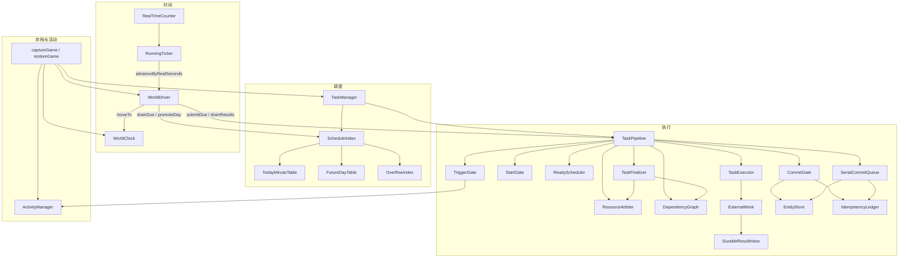
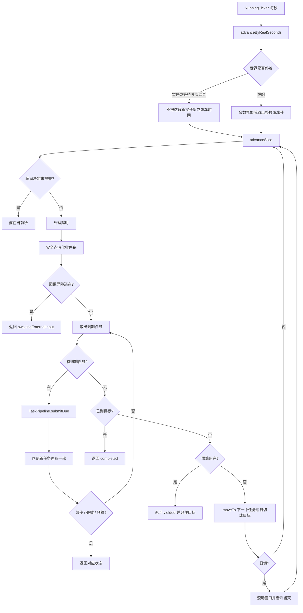
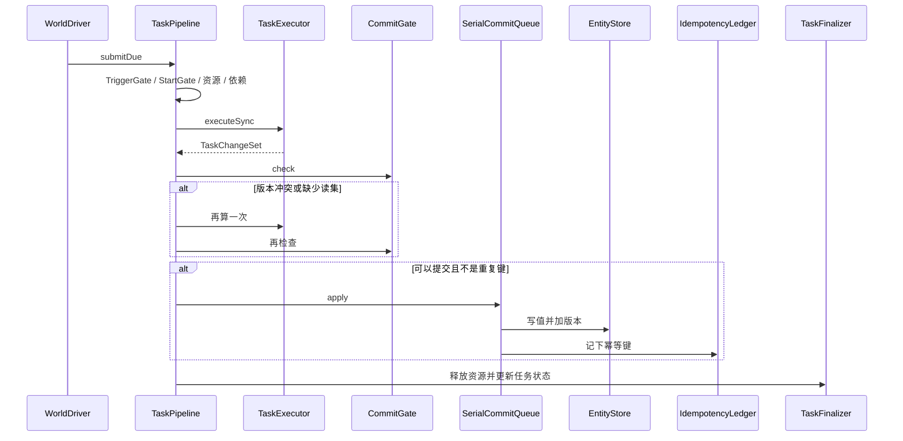
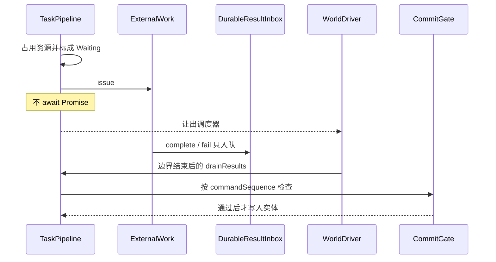
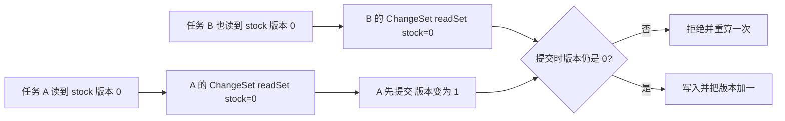
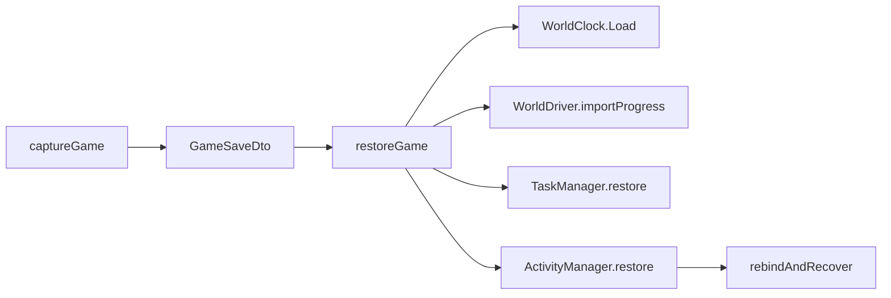

# 任务系统技术架构

> 对照实现：`assets/src/task`、`assets/src/world/world-driver.ts`、`assets/src/world/game-save.ts`。  
> 检查脚本：`scripts/check-task-engine.ts`。  
> 设计基线：[游戏任务系统最终方案](游戏任务系统最终方案.md)。索引细节见[任务队列数据结构评审](任务队列数据结构评审.md)。

## 1. 是不是「计算与提交分离 + 乐观并发 + 幂等 + 事务」

是这四件事，但各自的范围要说清楚。

| 说法 | 本系统里是什么 | 承担者 | 不是什么 |
| --- | --- | --- | --- |
| 计算与提交分离 | 处理函数只返回 `TaskChangeSet`，不直接改实体。检查通过后才写入。 | `TaskExecutor` 产出变更，`CommitGate` 检查，`SerialCommitQueue` 写入 `EntityStore` | 处理函数可以改自己的 `TaskRecord`（例如把 `nextSettleAt` 推到下一次）。那不是实体提交。 |
| 乐观并发控制 | 变更带 `readSet`：实体键 → 计算时看到的版本。提交时版本必须仍相等，否则拒绝并重算一次。 | `CommitGate`、`EntityStore.canCommit` / `apply` | 不是执行期间把实体锁住。执行期间的互斥是 `ResourceArbiter` 对 `resourceClaims` / `serialKey` 的占用，那是另一层。 |
| 幂等防重 | 每次提交带 `idempotencyKey`。账本里已有这把键，就不再写实体。 | `IdempotencyLedger`、`CommitGate` | 键默认等于 `executionId`。业务若自己复用同一把键，后一次会被当成已经提交过。 |
| 事务 | 一次 `apply` 在同一调用栈里写完实体并记下幂等键，中间不 `await`。门禁不通过则一份都不写。 | `SerialCommitQueue.apply` | 不是数据库事务。没有撤销日志。若写入过程中途抛错，已经写过的键不会自动回滚。当前命令都是纯赋值，正常路径是整份写入或写入前被拒绝。 |

资源占用和实体版本是两道闸：

- 资源占用：这条执行还没结束时，冲突的下一条不能启动。读可以并存，写和独占会挡住其他访问。
- 实体版本：两条执行都已经算出变更之后，仍要在提交时复验。先提交的把版本加一，后一份旧读集会失败。

## 2. 框架

播放器 `SessionPlayer` 和连续量结算 `ContinuousUpdater` 还是占位，没有接入这条循环。

## 3. 类的职责

### 3.1 时间

| 类 | 文件 | 职责 |
| --- | --- | --- |
| `RunningTicker` | `assets/src/runtime/running-ticker.ts` | 每秒推进真实计时，并把 1 真实秒交给 `WorldDriver`。不执行任务。 |
| `WorldClock` | `assets/src/world/world-clock.ts` | 保存累计游戏时间和倍速。`moveTo` 一次拨到目标秒，再发 `listen_advanced`。不决定下一个边界。 |
| `WorldDriver` | `assets/src/world/world-driver.ts` | 在线和离线共用的推进器。只跳到下一个任务、日切、暂停或目标时间。控制切片预算、暂停和未走完的目标。 |

### 3.2 任务登记与时间索引

| 类 | 文件 | 职责 |
| --- | --- | --- |
| `TaskManager` | `assets/src/task/task-manager.ts` | 登记任务、按类型重新绑定处理函数、取消、读档后重建索引。 |
| `TaskRepository` | `pipeline/task-repository.ts` | 任务主存储。直址表不能代替这里。 |
| `ScheduleIndex` | `schedule/schedule-index.ts` | 决定任务放进今日表、未来表还是 overflow，并记住插入时的槽位。 |
| `TodayMinuteTable` | `schedule/today-minute-table.ts` | 当天任务按日内分钟 `0..1439` 分槽。只扫到当前分钟。 |
| `FutureDayTable` | `schedule/future-day-table.ts` | 今天起五年内的任务按「绝对日 − 今天」分槽。今天前进时窗口跟着滑动。 |
| `OverflowIndex` | `schedule/overflow-index.ts` | 窗口外的任务。查询前再排序。 |
| `cadence.ts` | `schedule/cadence.ts` | 由结算档位算出周期长度，并决定末段不足时丢弃、按比例或改到 `activeUntil`。 |
| `task-order.ts` | `schedule/task-order.ts` | 同一时刻的顺序：时间、阶段、priority、sequence、id。数字小的先。 |

### 3.3 执行与提交

| 类 | 文件 | 职责 |
| --- | --- | --- |
| `TaskPipeline` | `pipeline/task-pipeline.ts` | 把一次到期走完：过滤、让路、执行、提交、收尾。也负责超时、取消和读档重发。 |
| `ExecutionRepository` | `pipeline/execution-repository.ts` | 每次触发一条执行记录。同一任务可以有多条。 |
| `TaskRuntime` | `pipeline/task-runtime.ts` | 处理函数和任务序号。函数不进存档。 |
| `TriggerGate` | `pipeline/trigger-gate.ts` | 取出时跳过已结束的任务；活动 revision 变了则标过期。 |
| `StartGate` | `pipeline/start-gate.ts` | 真正开始前检查 `startBefore` 和迟到策略。 |
| `ReadyScheduler` | `pipeline/ready-scheduler.ts` | 按比较器排队，并跳过队头受阻的任务。 |
| `ResourceArbiter` | `pipeline/resource-arbiter.ts` | 读可并存；写和独占互相挡住。一次声明要么全拿到，要么一个都不占。 |
| `DependencyGraph` | `pipeline/dependency-graph.ts` | `dependsOn` 里的执行编号没完成，这条就不能开始。 |
| `TaskExecutor` | `pipeline/task-executor.ts` | 调用同步处理函数或登记异步等待，并收成 `TaskChangeSet`。 |
| `ExternalWork` | `pipeline/external-work.ts` | 外部请求的关联号。`complete` / `fail` / `abort` 只入队。 |
| `DurableResultInbox` | `pipeline/result-inbox.ts` | 按 `commandSequence` 保存尚未提交的外部结果。 |
| `CommitGate` | `pipeline/commit-gate.ts` | 提交前检查幂等键、`commitBefore`、读集是否齐全、版本是否仍匹配。 |
| `EntityStore` | `pipeline/entity-store.ts` | 实体当前值和版本。只有提交能改版本。 |
| `IdempotencyLedger` | `pipeline/idempotency-ledger.ts` | 已提交的幂等键和提交序号。 |
| `SerialCommitQueue` | `pipeline/serial-commit-queue.ts` | 同步写入实体并记账。这段不能等待。 |
| `TaskFinalizer` | `pipeline/task-finalizer.ts` | 释放资源、唤醒依赖、把任务标成完成、活动中或过期。 |

### 3.4 活动与存档

| 类 | 文件 | 职责 |
| --- | --- | --- |
| `ActivityManager` | `assets/src/world/activity-manager.ts` | 持续过程的 revision。改道或取消时加一，旧边界在触发时失效。 |
| `captureGame` / `restoreGame` | `assets/src/world/game-save.ts` | 把时钟、余数、暂停、任务、执行、收件箱、幂等账本、实体版本和活动收成一份快照，再按记录重建索引。 |
| `WorldState` | `assets/src/world/world-state.ts` | 世界主状态占位。实体现在还在 `EntityStore`。 |

## 4. 一次在线推进

空分钟不会逐个走过。10 分到 16 分之间只有 12 分和 15 分有任务时，路径是 `10 → 12 → 15 → 16`。

## 5. 同步任务：计算和提交

处理函数返回空，就得到一份空变更，仍然走这道门，只是没有实体写入。

末段比例小于 1 时，提交前把「新值 − 旧值」乘上比例再四舍五入。比例只缩放这次差值，不把绝对目标值直接乘比例。

## 6. 异步任务：结果回流

`StopWorldUntilResult` 会把时钟停在发起那一秒，结果提交后才继续。`PauseWorld` 还要等 `resumeAfterDecision()`。`ContinueWorld` 下，后面不冲突的任务可以先跑；依赖这条结果的任务若错过 `startBefore`，按迟到策略处理，时钟不倒退。

## 7. 乐观并发怎么挡旧变更

重算会再调用一次处理函数。函数里如果发外部请求或改任务自己的字段，会做两遍。重算只应该重新读实体并返回新的变更。

## 8. 存档

快照包含时钟、换算余数、未完成目标、暂停标记、任务主记录、执行记录、收件箱、幂等账本、实体版本和活动 revision。

不包含处理函数、Promise、直址表位图和堆。读档顺序是：摆钟、恢复推进进度、重建任务索引和执行、恢复活动，最后按任务类型重新绑定处理函数。`Retry` / `Reissue` 在绑定之后再发一次。

